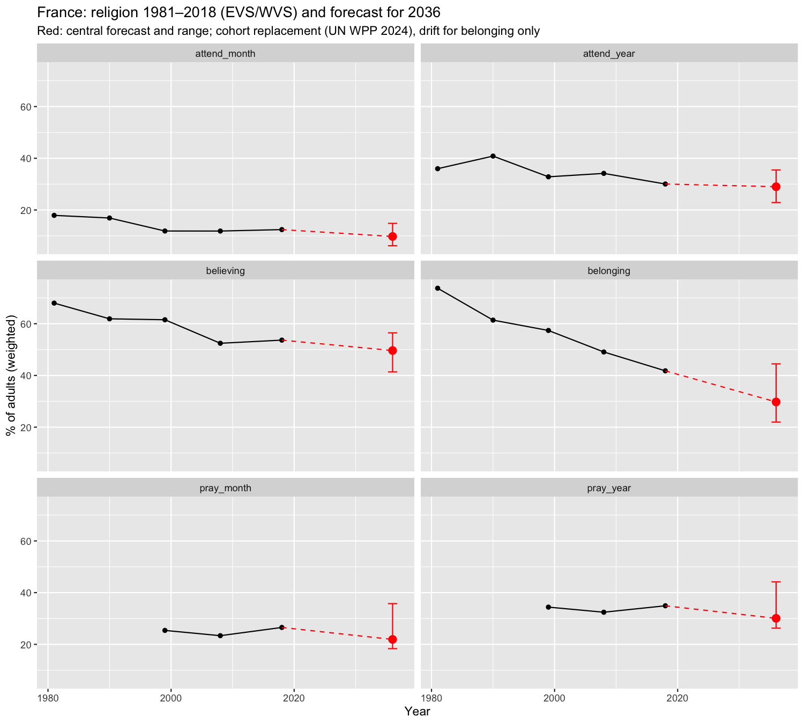

# Believing without belonging: religion in France, 2036

*In 1981, more French people belonged to a church than believed in God. Today it is the other way round, and by 2036 the gap will be wider than ever.*

## Why France

France is one of the most secular countries in Europe, and it is changing fast. In 2025, for the first time since the Second World War, more people died than were born (645,000 births vs 651,000 deaths, INSEE). The population is ageing, and immigration and national identity dominate politics: the radical-right Rassemblement National came first in the 2024 parliamentary election with about 33% of the first-round vote. Religion is part of this debate. Among adults aged 18–59, 51% say they have no religion, 29% are Catholic, 10% Muslim and 10% follow other religions (INSEE/INED survey "Trajectories and Origins", 2019–2020).

## How the forecast works

The forecast draws on five waves of the European Values Study and World Values Survey (1981–2018, about 7,200 French adults). The key idea: how religious people are depends largely on the generation they were born into, and changes little over their lifetime. So the future depends mostly on who replaces whom: older, more religious generations are dying out, and younger ones take their place. Combining each generation's current religiosity with UN population projections gives the 2036 estimate. Only for belonging does the model add a further decline, because people of every generation have been steadily leaving churches. The ranges mainly reflect uncertainty about today's teenagers, whom the survey barely covers. When tested on the past (predicting 2018 from data up to 2008), the method placed every real value within its range.

## The great crossover

In 1981, 74% of French adults belonged to a religion, but only 68% believed in God: many were Catholics by family tradition rather than by conviction. Around 1990 the two lines crossed. By 2018, 54% believed but only 42% belonged. The forecast for 2036 widens the gap further: about 50% believing, but only about 30% belonging. In other words, for many French people faith is becoming a private matter, detached from any church.

## Believing: slowly fading

In 2018, 53.7% of French adults said they believe in God (68% in 1981, 52.4% in 2008). The model expects **about 50% in 2036 (range 41–56%)**. Belief is strongest among people born in the 1930s (75%) and close to 50% among everyone born from the 1970s onwards. As the oldest generations disappear, the average slips, but today's young adults are no less believing than their parents, so the fall is slow. My own forecast expected less belief; the direction is right, but the decline is smaller than I thought.

## Belonging: the biggest change

In 2018, 41.8% of adults named a religious denomination, down from 73.7% in 1981 and 49.1% in 2008. This is the only dimension where people themselves keep leaving, generation after generation. Forecast: **about 30% in 2036 (range 22–44%)**, so roughly seven in ten adults would belong to no religion. This contradicts my own forecast that belonging would stay stable thanks to a growing Muslim community. The Muslim share among respondents is indeed growing (0.4% in 1981, 3.3% in 2008, 5.8% in 2018), but it is still far too small to offset the Catholic decline.

## Practice: rare but stable

I measured practice at two levels. **Monthly** attendance shows regular religious life; **yearly** attendance also captures people who go only at Christmas, Easter, weddings or funerals, which in France is often a family or cultural habit rather than faith. Monthly attendance: 17.9% in 1981, 12.4% in 2018 → **about 10% in 2036 (6–15%)**. Yearly attendance: 30% in 2018 → **29% in 2036 (23–35%)**. Praying at least once a month: 26.5% in 2018 → **22% in 2036 (18–36%)**. Regular practice is concentrated among people born before 1940 (25% attend monthly, against 8–15% of younger generations). This matches my own forecast of a slight decrease.

## The new face of the believer

The people who still practise in 2036 will look different from those of 1981. The Muslim share among respondents has grown from 0.4% in 1981 to 5.8% in 2018, and Muslims practise more often than Catholics: according to INSEE, only 8% of Catholics attend a place of worship regularly, compared with just over 20% of Muslims. So while France as a whole becomes less religious, the small group of regular worshippers is likely to become older on the Catholic side and more diverse overall. This may also explain why religion remains so visible in French politics even as fewer people belong to a church.

## Limitations

- In 2018 several measures rose in many generations at once; we cannot tell whether this is a real change or a survey effect.
- People born after 2000 will be about 29% of adults in 2036, but the survey has almost no data on them.
- Migration and the religion of newcomers are not modelled separately. The survey probably under-represents Muslims (5.8% of respondents vs about 10% of 18–59-year-olds in INSEE data), so belonging may be slightly underestimated.
- The method was tested once, over 10 years; 2036 is 18 years away.

## Summary

In 2036 France will probably still be a country where about half of adults believe in God, but only about three in ten belong to a religion and one in ten practises regularly: "believing without belonging". The main driver is not people changing their minds, but one generation replacing another.

*Sources: EVS/WVS joint dataset (GESIS ZA7503); UN World Population Prospects 2024; INSEE, Bilan démographique 2025; INSEE/INED, Trajectoires et Origines 2 (2019–2020); French Ministry of the Interior, 2024 legislative election results.*
